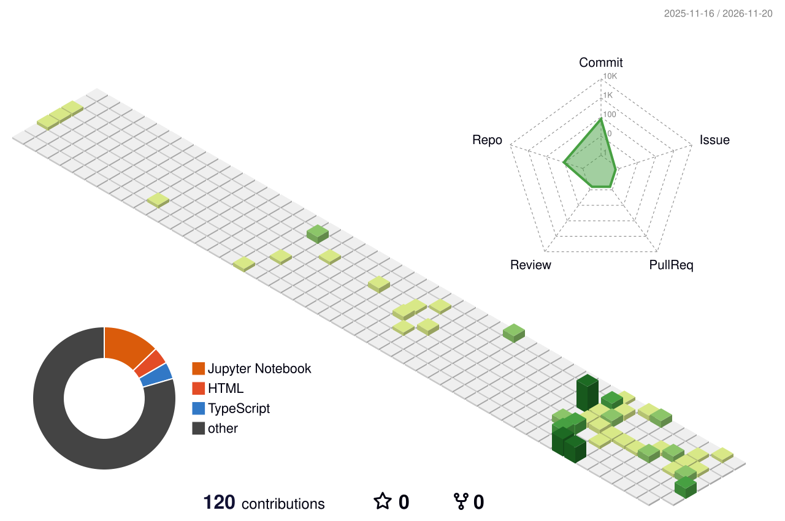

## Introducing myself 🙋🏻‍♀️
Hello, my name is Elza. I'm a Data/AI engineer with expertise in Big data, Data Analysis, Machine Learning, Reporting, and Cloud Architecture.

## Portfolio 💼
Data Analytics & Engineering: View [Portfolio](https://github.com/ElzaJung/Elza-s-Portfolio)

Full-Stack Software Engineering: View [Portfolio](https://github.com/ElzaJung/SE-portfolio)

## Tools ⚒️
Language: SQL, Python, JavaScript, Java \
Database: Google BigQuery, PostgreSQL, MySQL \
Data Visualization: Tableau, Power BI \
Skills: Bash, Linux, Docker, AWS, GCP, Azure \
Framework/Libraries: React, Next.js, TypeScript, Tailwind CSS, FastAPI, Express

